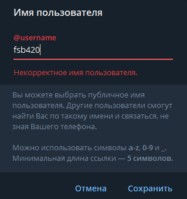

# Маски ников Telegram

Скрипт раскрывает маску и проверяет каждый ник. Заглавная `X` — цифра.



## Насколько это трудно

Понять, что Telegram удержал ник, можно только ответом `account.checkUsername` из вошедшего аккаунта. Страницы `t.me` и Fragment этого не показывают. Вход для такой проверки довести до конца не удалось: код приходил только внутрь приложения, без SMS и без почты, а в чате его не было. С российского адреса своё приложение на [my.telegram.org](https://my.telegram.org) не создаётся, VPN эту блокировку не снимает. Разобрать, какие ники сервер зажал, поэтому долго и из России заметно труднее.

Ники, которые имеет смысл вбить в клиент руками, собраны в [docs/candidates.md](docs/candidates.md). Это не список свободных.

```text
python check.py --expand zovXX
python check.py --http zovXX zovXXX
```

`zovXX` — это `zov00`…`zov99`. `zovXXX` — `zov000`…`zov999`.

## Что показывает клиент

У поля «Имя пользователя» три разных ответа, и это три разных ошибки метода [`account.checkUsername`](https://core.telegram.org/method/account.checkUsername).

| В приложении | Ошибка API | Что это |
| --- | --- | --- |
| можно сохранить | `true` | ник свободен |
| ссылка уже занята | `USERNAME_OCCUPIED` | ник у кого-то есть |
| выставлена на продажу | `USERNAME_PURCHASE_AVAILABLE` | ник продаётся на [Fragment](https://fragment.com) |
| некорректное имя пользователя | `USERNAME_INVALID` | формально имя правильное, но сервер его не отдаёт |

Последняя строка и есть удержание. Длина и символы в порядке (латиница, цифры, от 5 до 32, не с цифры), страницы `t.me/ник` нет, лота на Fragment тоже нет. Клиент всё равно пишет «Некорректное имя пользователя». Пока администрация не выставит такой ник на Fragment, купить его тоже нельзя: ошибка сменится на «выставлена на продажу» только после этого.

Так вели себя, например, `fsb420` и `fsb555`. `fsb999` при той же пустой странице `t.me` уже был на продаже, и клиент честно показал Fragment.

## Почему проверка по сайту врёт

`t.me` для ника без профиля выглядит одинаково и у свободного, и у удержанного, и у того, что уже продаётся. Фраза “you can contact” есть и у занятых страниц, на неё опираться нельзя. Признак занятого профиля — блок `tgme_page_extra`. Признак продажи — страница `fragment.com/username/…` со статусом Available, а не редирект в поиск.

Этого мало, чтобы сказать «свободен». Свободен только тот ник, по которому `account.checkUsername` вернул `true`. Метод доступен только из вошедшего аккаунта, поэтому сессия лежит локально и в репозиторий не входит.

## Проверка как в клиенте

Ключи и файл `.env` расписаны в [гайде](docs/api-credentials.md). Там же — почему с российского адреса форма отвечает `Too many attempts`, и почему VPN эту строку не убирает. Коротко:

1. На [my.telegram.org](https://my.telegram.org) создать приложение и взять `api_id` и `api_hash`. Подробности в [гайде](docs/api-credentials.md).
2. Скопировать `.env.example` в `.env` и вписать их.
3. Войти один раз: `python check.py --login`. Код придёт в Telegram. Файл `tg.session` не коммитить.
4. Прогнать маску тем же методом, что поле в настройках:

```text
python check.py --mt zovXX zovXXX
```

Между запросами пауза `--delay` (по умолчанию 0.4 с). Если сервер ответит `FLOOD_WAIT`, скрипт ждёт указанное время.

Статусы в tsv:

- `free` — сервер разрешил занять
- `reserved` — `USERNAME_INVALID` при нормальной форме, ник удержан
- `sale` — только покупка на Fragment
- `taken` — уже занят
- `unconfirmed` — режим `--http`: публично пусто, свободен он или удержан, неизвестно
- `invalid` — не проходит правило символов
- `error` — запрос не удался

Без `--mt` и без сессии скрипт сам не называет ник свободным.
